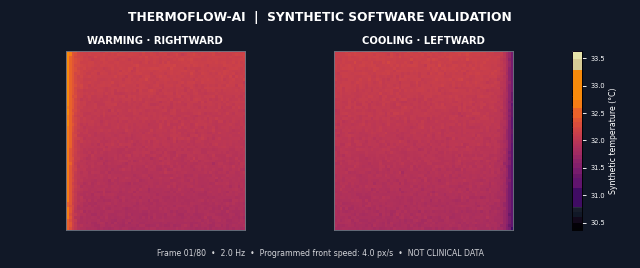
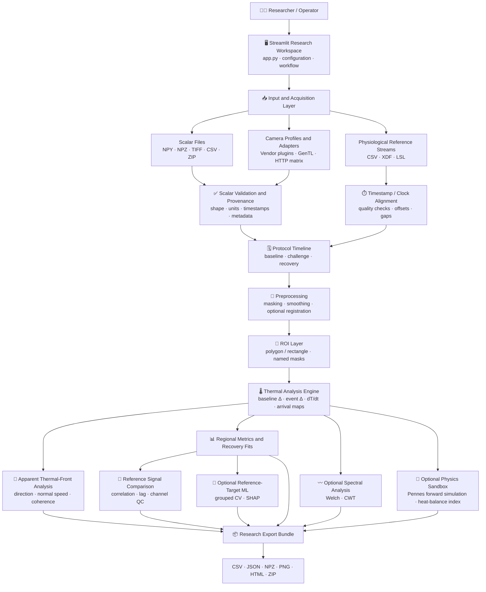

# 🌡️ ThermoFlow-AI

     

**An interactive research platform for sequential thermal-image analysis, spatiotemporal temperature mapping, apparent thermal-pattern propagation, multi-ROI analysis, camera integrations, and synchronized physiological reference signals.**

> ⚠️ **Research / engineering demonstration only.** Thermal cameras observe emitted infrared radiation. Properly calibrated radiometric data can estimate surface temperature, but this application does not directly measure blood flow, diagnose vascular disease, or provide treatment recommendations. Direction and speed outputs describe apparent propagation of a thresholded surface-temperature pattern — not vascular direction or blood-flow velocity. No clinical validation is claimed.

## 🎬 Interactive synthetic walkthrough

The animated preview below compares the two deterministic sequences included for software validation.



- [Open the warming analysis summary](results/synthetic_demo/sequence_01_warming_right/analysis_summary.png)
- [Open the cooling analysis summary](results/synthetic_demo/sequence_02_cooling_left/analysis_summary.png)
- [View the synthetic demo metrics](results/synthetic_demo/demo_results.json)

> **Demo disclosure:** These are generated synthetic sequences with programmed rightward warming and leftward cooling fronts. They are not human or animal recordings, real camera captures, measured perfusion signals, or evidence of clinical accuracy. The measured front speeds validate the software against the known synthetic motion only. Real-device and real-participant validation must be performed separately.

---

## 🌐 Platform Overview

| Capability | Description |
| --- | --- |
| **Thermal Sequence Input** | NPY · NPZ · Multi-page TIFF · CSV · ZIP of ordered grayscale frames · image folder |
| **Camera Catalogue** | 30 selectable profiles covering major thermal-camera vendors, scientific/industrial cameras, OEM cores, thermopile arrays, GenICam/GenTL, generic HTTP matrix gateways, and custom devices |
| **Camera SDK Integration** | Capability-aware plugin discovery, device probing, health checks, dynamic SDK parameters, configuration readback, finite capture, and native decoding when a compatible adapter is installed |
| **Generic Acquisition** | Scalar radiometric file import · configurable HTTP JSON matrix endpoint · GenTL/Harvester for compatible CTI producers |
| **Detector Metadata** | Form factor · detector technology · spectral band · physical interface · output representation · calibration state · pixel format |
| **Anatomical ROIs** | Browser-side polygon and rectangle drawing · named regions · up to eight ROIs · overlap and geometry checks |
| **Multiple ROI Analysis** | Per-frame mean, median, standard deviation, Δ-temperature/intensity, temporal derivative, warming/cooling fractions, and pixel coverage |
| **Protocol Timeline** | Continuous baseline → challenge → recovery, or baseline + rewarming when the challenge interval was not recorded |
| **Thermal Dynamics** | Baseline-relative Δ maps · event-relative progression maps · dT/dt · first-arrival maps · apparent front direction and speed |
| **Preprocessing** | Optional spatial Gaussian denoising · optional temporal smoothing · conservative translational registration with visible shift diagnostics |
| **Recovery Analysis** | Descriptive exponential rewarming time constant and fit quality for each eligible ROI |
| **Temporal Signal Analysis** | Welch power spectrum · optional continuous wavelet scalogram · protocol-gap-aware processing |
| **Reference Sensors** | LSCI · laser-Doppler · PPG · ECG · GSR/EDA · probe temperature · ambient measurements · custom timestamped signals |
| **Sensor Acquisition** | CSV · XDF/LabRecorder · live finite LSL channel capture with clock metadata and quality checks |
| **AI ROI Suggestions** | Optional user-supplied YOLO segmentation weights trained or validated on thermal imagery; suggestions remain manually reviewable |
| **Reference-Target ML** | Participant-grouped Random Forest / Extra Trees / optional XGBoost regression using independently measured reference labels |
| **Explainability** | Optional global SHAP feature contributions for supported tree models; not causal inference |
| **Physics Sandbox** | Configurable one-dimensional Pennes forward simulation and optional paper-derived heat-balance index under documented assumptions |
| **Reproducible Export** | ROI geometry · protocol timeline · regional/union CSV · summary JSON · NPZ arrays · PNG · standalone Plotly HTML · ZIP bundle |

---

## 🏗️ Architecture



The Streamlit application orchestrates the workflow. The `thermoprop` package contains the processing, protocol, ROI, quality, modelling, and integration modules. Camera SDKs are isolated behind Python entry-point adapters. Optional research dependencies are installed separately so a basic scalar-sequence workflow does not require every vendor SDK or AI library.

---

## 🔄 Per-Sequence Analysis Flow

```mermaid
flowchart LR
    INPUT["🎞️ Load scalar frames"] --> CHECK["🔎 Validate array, units<br/>and timestamps"]
    CHECK --> PROTOCOL["🗓️ Build protocol timeline"]
    PROTOCOL --> PRE["🧹 Denoise / optional registration"]
    PRE --> ROI["🎯 Apply named ROI masks"]
    ROI --> BASE["📐 Pre-protocol baseline"]
    BASE --> DELTA["🌡️ Baseline Δ and event-relative Δ"]
    DELTA --> RATE["〰️ dT/dt within recorded segments"]
    RATE --> THRESH["🚦 Noise-aware threshold crossing"]
    THRESH --> ARRIVAL["🗺️ First-arrival maps"]
    ARRIVAL --> FRONT["🧭 Apparent front direction / speed"]
    FRONT --> METRICS["📊 Regional metrics and QC"]
    METRICS --> EXPORT["📦 Reproducible outputs"]
```



### Core measurements

Pre-protocol baseline temperature/intensity is calculated per pixel as:

\[
T_0(x,y)=\operatorname{median}_{t\in B}T(x,y,t)
\]

Baseline-relative change is:

\[
\Delta T_0(x,y,t)=T(x,y,t)-T_0(x,y)
\]

For a post-cooling rewarming recording, the skin can warm while remaining below its pre-cooling baseline. ThermoFlow-AI therefore maintains a separate event-relative reference:

\[
T_e(x,y)=\operatorname{median}_{t\in E}T(x,y,t),\qquad
\Delta T_e(x,y,t)=T(x,y,t)-T_e(x,y)
\]

The first-arrival-time field \(t_a\) is used to estimate the apparent local normal direction and speed of a thresholded surface-temperature pattern:

\[
\mathbf{n}=\frac{\nabla t_a}{\lVert\nabla t_a\rVert},\qquad
v_n=\frac{1}{\lVert\nabla t_a\rVert}
\]

Speed is reported in px/s unless a documented pixel pitch is provided, in which case the output can be converted to mm/s. It is not a blood-flow velocity.

---

## 🧭 Protocol Modes and Timing

| Protocol | When to use it | Timing behaviour |
| --- | --- | --- |
| **Baseline + rewarming (challenge not recorded)** | The recording contains a pre-challenge baseline followed by a separate recovery/rewarming segment | Inserts a derivative discontinuity at the boundary. Does not invent challenge frames. Unknown challenge duration is omitted unless independently documented. |
| **Continuous baseline → challenge → recovery** | All three phases are present in the recording | Operator supplies challenge start and exclusive end frame. Derivatives are computed only across observed continuous segments. |
| **Uploaded timestamps** | Acquisition provides one timestamp per frame | Requires finite, strictly increasing values. Large gaps are flagged; their meaning is not guessed. |
| **Nominal frame rate** | No usable per-frame timestamps are available | Uses the configured FPS and labels the timebase as nominal/recorded time. |

> Do not select a recorded challenge phase if the stimulus interval is absent from the recording. The DIRT-SR38 workflow uses **Baseline + rewarming (challenge interval not recorded)**.

---

## 🎯 ROI Editor

- **Polygon:** select Polygon, click vertices on the chosen reference frame, name the region, then finish the shape.
- **Rectangle:** select Rectangle and click two opposite corners.
- **Undo:** remove the most recent pending vertex or saved region.
- **Full-frame preset:** add a clearly named full-frame region.
- **Multiple ROIs:** save and compare up to eight named regions.
- **Overlap checks:** overlapping masks are allowed but reported; overlapping pixels should not be summed as independent tissue.
- **No manual ROI:** the application can use a clearly labelled full-frame analysis region.

All regional metrics are extracted from the same full-resolution analysis pass. Only the browser preview is downsampled for responsive playback.

---

## 📷 Camera and Acquisition Support

ThermoFlow-AI exposes **30 selectable camera/acquisition profiles**. Selecting a vendor profile records the intended camera family and reveals the documented acquisition routes; it does not install a proprietary SDK or guarantee that every model supports live capture.

| Acquisition path | What is available | Requirement / limitation |
| --- | --- | --- |
| **Generic scalar files** | NPY · NPZ · TIFF · CSV · ZIP image sequences | Working portable import path; frames must be numeric scalar data. |
| **Generic HTTP JSON matrix** | Configurable endpoint and radiometric matrix decoding | Endpoint must be documented by the camera/vendor or supplied gateway; no undocumented URL is guessed. |
| **GenICam / GenTL** | Device discovery and finite scalar-component capture through Harvester; optional exposure/gain/FPS node controls | Requires the camera manufacturer's compatible CTI Producer. Counts are not automatically °C. |
| **Vendor adapter plugin** | Native file decoding, device discovery, health check, configuration, and acquisition methods when implemented | Requires the exact vendor SDK, license, OS/driver support, camera model, and a compatible `thermoprop.camera_adapters` plugin. |
| **Multi-camera** | Adapter-mediated finite capture with separate recordings and per-device timestamps | Synchronization method must be declared; it is only marked verified when the adapter explicitly confirms it. Heterogeneous camera fusion is not automatic. |

### Selectable camera profiles

FLIR / Teledyne FLIR · InfraTec · Optris · Seek Thermal · HIKMICRO · Hikvision · Testo · Fluke · InfiRay · Guide Sensmart · Workswell · Xenics / Exosens · Telops · Sierra-Olympic · Axis · MOBOTIX · Basler · Allied Vision · IDS · LUCID Vision Labs · Teledyne DALSA · XIMEA · Raptor Photonics · New Imaging Technologies (NIT) · smartphone thermal cores · thermopile arrays · GenICam / GenTL · generic HTTP / ISAPI matrix · Generic / research dataset · Other / custom.

### Camera SDK / capability check

1. Select **Live camera acquisition** or **Upload thermal recording** in the sidebar.
2. Choose the camera profile and the connection workflow appropriate to the device.
3. Open **Camera SDK and capability status**.
4. Review whether the adapter is installed and whether probing, health checks, configuration, native decoding, or acquisition are actually available.
5. Use **Discover connected cameras** and the non-destructive health check only when the selected adapter provides those capabilities.
6. Apply only adapter-declared settings. The application checks the declared type/range and reads settings back where supported.

For exact vendor requirements, see [Camera Support Matrix](docs/CAMERA_SUPPORT_MATRIX.md) and [Integrations Guide](docs/INTEGRATIONS.md). A 16-bit image may represent raw counts, linearized counts, radiance, or calibrated temperature. RGB/pseudocolour video is not accepted as a quantitative temperature matrix.

---

## 🧪 Physiological Reference Signals

The application can import and compare timestamped reference channels such as:

| Modality | Typical interpretation | Important boundary |
| --- | --- | --- |
| **LSCI** | Spatial microvascular perfusion-related index | Independent reference when properly acquired; units and motion sensitivity are instrument-specific. |
| **Laser Doppler** | Local microvascular flux | Local sampling volume; not interchangeable with whole-ROI flow. |
| **PPG** | Pulsatile blood-volume signal / pulse waveform | Complementary systemic or local signal; not a direct substitute for LSCI. |
| **ECG** | Cardiac electrical timing | Useful for synchronization/physiological context, not local perfusion. |
| **GSR / EDA** | Electrodermal/autonomic response | Not a direct blood-flow measurement. |
| **Probe / ambient sensors** | Local or environmental temperature, humidity and related acquisition context | Requires sensor calibration, placement and clock provenance. |

Supported paths:

- **CSV:** numeric time and value columns, per-channel units, modality, and clock offset.
- **XDF / LabRecorder:** optional `pyxdf` import; choose a stream and numeric channel. Clock synchronization and de-jitter are separate choices; de-jitter defaults off.
- **Live LSL:** optional `pylsl` discovery and finite channel capture. Outlet clock correction is recorded. A separate camera-to-LSL offset is needed if the thermal camera clock is independent.

Correlation and lag outputs are descriptive. They do not establish causality or absolute perfusion calibration. See [Integrations Guide](docs/INTEGRATIONS.md).

---

## 🤖 Optional AI, Modelling and Physics Integrations

| Module | Technology | Purpose / boundary |
| --- | --- | --- |
| **Thermal ROI suggestions** | User-supplied YOLO segmentation weights | Proposes masks on thermal imagery. Weights must be trained/validated on a comparable thermal domain and results must be reviewed. A single-frame suggestion is not automatic temporal tracking. |
| **Reference-target regression** | scikit-learn Random Forest / Extra Trees; optional XGBoost | Predicts the supplied independent reference target from participant/session/ROI features. Uses participant-grouped cross-validation; not valid without suitable labels. |
| **Explainability** | SHAP | Global feature contributions for supported tree models. Explanations are not causal effects. |
| **Temporal features** | Welch PSD; optional PyWavelets CWT | Exploratory frequency/time-frequency analysis, only when frame rate, duration and camera sensitivity support the requested band. |
| **Bioheat sandbox** | One-dimensional Pennes forward simulation | Sensitivity/scenario exploration; not an inverse solver for an individual's perfusion. |
| **Paper-derived heat-balance index** | Optional calibrated-Celsius model | Requires calibrated Celsius input and ambient temperature; model-dependent output, not direct measured perfusion. |
| **Experiment tracking** | Optional MLflow | Logs analysis parameters, metrics and artifacts for reproducibility. |
| **Data versioning** | Optional DVC | Version data and validation pipelines; not required to run the application. |

Install optional features individually. The core sequence workflow does not require all extras:

```powershell
# Camera vision / GenTL support
pip install -e ".[vision]"

# Thermal-domain YOLO ROI suggestions
pip install -e ".[ai]"

# XDF import and live LSL reference channels
pip install -e ".[sensors]"

# Participant-grouped reference model training
pip install -e ".[ml]"

# XGBoost reference model
pip install -e ".[ml-xgboost]"

# SHAP explainability
pip install -e ".[explainability]"

# Wavelet scalograms
pip install -e ".[wavelets]"

# MLflow experiment tracking / DVC data versioning
pip install -e ".[tracking]"
pip install -e ".[data-versioning]"

# Larger research bundle (installs several optional dependencies)
pip install -e ".[research]"
```

Supervised thermal-to-reference modelling requires paired independent labels, at least six distinct participants and sufficient participant/ROI rows. Frames from the same participant must not be split across training and validation folds. A model trained on synthetic demonstration data is not a valid perfusion model.

---

## 🚀 Quick Start (Windows PowerShell)

```powershell
# 1. Create and activate a virtual environment
py -3.12 -m venv .venv
.\.venv\Scripts\Activate.ps1

# 2. Install the application
python -m pip install --upgrade pip
python -m pip install -r requirements.txt
python -m pip install -e .

# 3. Launch the interactive research workspace
streamlit run app.py

# 4. Run the automated test suite
python -m pytest -q

# 5. Compile-check the application and package
python -m compileall -q app.py src tests examples
```

The app opens in the browser at `http://localhost:8501` unless Streamlit selects another available port.

### Command-line analysis

The CLI is useful for repeatable scalar-array analysis and batch workflows:

```powershell
# Analyze one scalar thermal sequence
thermoprop .\data\sequence.npy `
  --output .\results\sequence_01 `
  --fps 3 `
  --baseline-frames 90 `
  --threshold 0.25 `
  --units "relative intensity"

# Inspect CLI options
thermoprop --help
```

Supported CLI inputs: NPY · NPZ · multi-page TIFF · CSV · ZIP of ordered grayscale images · image folder. The Streamlit application provides the richer protocol, multi-ROI, camera, sensor and export workflow.

---

## 🔬 DIRT-SR38 Real-Sequence Test Plan

**DIRT-SR38** is the recommended next dataset for testing sequential rewarming behaviour:

- [Zenodo dataset record](https://doi.org/10.5281/zenodo.19241293)
- [CVPR 2026 Workshop paper](https://openaccess.thecvf.com/content/CVPR2026W/PBVS/papers/Clarys_DIRT-SR38_A_Real_Paired_Cross-Sensor_Thermal_Sequence_Dataset_for_Super-Resolution_CVPRW_2026_paper.pdf)

The dataset paper describes 38 healthy adult female participants. Each subject has a 30-second steady-state baseline (90 frames) and a four-minute rewarming sequence (720 frames), totaling 810 aligned LR/HR frame pairs. The cooling stimulus occurs between the recorded baseline and rewarming sequences; the cooling interval itself is not supplied as a recorded image phase. Released PNGs are normalized 8-bit/16-bit intensity data, not calibrated Celsius measurements. The LR sequence is 108 × 108 and the HR sequence is 216 × 216; the reported LR sampling is 3 Hz.

### Suggested first real-data run

1. Download the dataset and select one participant and one modality only (LR **or** HR).
2. Put that participant's 90 baseline frames first, followed by the 720 rewarming frames, in natural filename order in one ZIP folder.
3. Do not mix participants, LR and HR modalities, or unrelated sequences in one upload.
4. Upload the ZIP in ThermoFlow-AI and choose **relative intensity**, not °C.
5. Set nominal frame rate to **3 Hz** and baseline length to **90 frames**.
6. Choose **Baseline + rewarming (challenge interval not recorded)**.
7. Leave the missing challenge duration unconfirmed unless an independent source provides it. The app splits derivatives/smoothing at the boundary without inventing frames.
8. Inspect the event-relative progression map, named ROI metrics, threshold-sensitivity view and acquisition QC.
9. Repeat with a second participant. Report both results separately; do not treat frames as independent participants.

> This dataset supports relative sequence analysis and super-resolution research. Its normalized PNG values cannot validate absolute Celsius accuracy or blood-flow estimates.

---

## 🧪 Tests & Validation

```powershell
# Automated tests
python -m pytest -q

# More detail for skipped optional-dependency tests
python -m pytest -q -rs

# Python compile check
python -m compileall -q app.py src tests examples
```

The packaged synthetic demonstration contains two deterministic 80-frame sequences (64 × 64 pixels, 2 Hz):

| Sequence | Programmed pattern | Estimated result | Software-validation result |
| --- | --- | ---: | --- |
| **01 — Warming** | Rightward, 4.00 px/s | Rightward, 4.027 px/s | Direction coherence 0.9997 |
| **02 — Cooling** | Leftward, 4.00 px/s | Leftward, 4.031 px/s | Direction coherence 0.9995 |

The current project test suite contains **84 automated tests** in the packaged source tree; optional ML / SDK tests may be skipped when their dependencies or hardware are not installed. Synthetic tests and fake adapters validate software behaviour, not physical camera interoperability or physiological accuracy. Run the commands above in your own environment and retain the actual output from that environment.

---

## 🏛️ Modular Architecture & Separation of Concerns

| Layer | Responsibility |
| --- | --- |
| **Streamlit UI / Workflow** | Camera selection, uploads, protocol configuration, ROI interaction, analysis controls, visualizations and exports |
| **Core Analysis** | Baseline, event-relative change, temporal derivatives, thresholding, front-arrival maps and propagation descriptors |
| **Protocol / Timebase** | FPS or timestamp validation, observed phase labels, missing challenge gaps and derivative discontinuities |
| **ROI / Geometry** | Polygon validation, rasterization, named masks, overlap reporting and regional time-series extraction |
| **Preprocessing / QC** | Invalid-value handling, denoising, optional registration, acquisition-quality indicators and motion-shift reporting |
| **Camera Integration Layer** | Camera profiles, SDK discovery, plugin adapters, GenTL and generic HTTP matrix acquisition |
| **Reference Signal Layer** | CSV/XDF/LSL ingestion, clock offsets, sample quality, alignment, correlation and lag analysis |
| **Research Extensions** | YOLO ROI suggestions, grouped ML, SHAP, Welch/CWT, Pennes simulation and MLflow/DVC hooks |
| **Export Layer** | CSV, JSON, NPZ, PNG, interactive HTML and complete ZIP archive |

The camera plugin interface follows a replaceable-adapter approach through the `thermoprop.camera_adapters` Python entry-point group. Optional dependencies are isolated in `pyproject.toml` extras. This is a modular research application; it should not be described as a fully validated medical-device architecture.

---

## 📄 Analysis Output

Each completed analysis can export:

- `summary.json` — sequence metadata, units, protocol, baseline/noise information, event coverage, propagation estimates and interpretation notes.
- `frame_metrics.csv` — union ROI measurements by frame.
- `regional_metrics.csv` — measurements for each named ROI.
- `thermal_analysis_arrays.npz` — baseline, baseline Δ, event Δ, temporal derivative, ROI masks and first-arrival arrays.
- `analysis_summary.png` — static multi-panel figure.
- `thermal_frame_player.html` — standalone interactive Plotly frame player.
- `roi_geometry.json` — named polygon/rectangle definitions.
- `protocol_timeline.json` — observed phases, timestamps and gap metadata.
- `provenance_manifest.json` — source/configuration/calibration and processing metadata, with sensitive credential values redacted.

Example excerpt from the packaged **synthetic** warming run:

```json
{
  "sequence_name": "sequence_01_warming_right",
  "n_frames": 80,
  "height": 64,
  "width": 64,
  "fps_effective": 2.0,
  "units": "°C (synthetic)",
  "overall_classification": "predominantly warming",
  "warming_propagation": {
    "direction": "right",
    "median_front_speed": 4.0266,
    "speed_unit": "px/s",
    "direction_coherence_0_to_1": 0.9997
  },
  "interpretation": "Apparent thermal-front propagation only; not a measurement of blood-flow direction or perfusion."
}
```

The example is deterministic synthetic validation output. Replace it with results from real, appropriately calibrated and documented recordings before making experimental claims.

---

## ⚠️ Known Limitations

| Area | Limitation |
| --- | --- |
| **Physiology** | Surface temperature is influenced by perfusion and multiple other thermal/environmental processes; it is not a direct blood-flow measurement. |
| **Calibration** | Selecting °C is a label, not a calibration operation. Raw counts, radiance and relative intensity must not be treated as Celsius. |
| **Camera Drivers** | Vendor profiles are selectable, but proprietary native decoding/live acquisition require the exact SDK, license, model support and a tested adapter. |
| **GenTL** | Requires a compatible manufacturer CTI Producer; generic transport does not guarantee radiometric calibration. |
| **HTTP Matrix** | Requires a vendor-documented numeric matrix endpoint or gateway. Palette RTSP video is not a quantitative temperature map. |
| **Multi-camera** | Recordings remain separate; synchronization must be documented and verified by the adapter. Cross-vendor fusion is not automatic. |
| **Motion** | Current registration is conservative translation/affine support depending on selected path; inspect shifts because registration can suppress real thermal motion. |
| **AI ROI** | YOLO masks are suggestions and require thermal-domain weights and operator review; generic RGB models are not assumed valid. |
| **Machine Learning** | Reference regression needs independent paired labels, adequate participant count, grouped validation and external cohort testing. SHAP does not establish causality. |
| **Physics** | Pennes is a forward sensitivity sandbox; the optional paper-derived index is model-dependent. Neither is an individual direct perfusion measurement. |
| **Dataset** | DIRT-SR38 distributed PNGs are normalized intensity, not radiometric Celsius data. |
| **Validation** | Synthetic tests and open datasets do not replace real-device calibration, test-retest studies, independent perfusion references or clinical validation. |
| **Medical Use** | Not a medical device. Do not use for diagnosis, triage, treatment decisions or patient management. |

---

## 📚 Research References & Related Projects

### Reference papers

1. [Facial thermal and blood-perfusion patterns of human emotions: Proof-of-concept (2023)](https://doi.org/10.1016/j.jtherbio.2023.103464) — supplied reference paper; relevant to facial thermal dynamics and perfusion-related hypotheses.
2. [Thermal Infrared Imaging to Evaluate Emotional Competences in Nursing Students (2020)](https://pmc.ncbi.nlm.nih.gov/articles/PMC7248891/) — supplied reference paper; useful for acquisition phases, facial ROIs and temperature-time observations.
3. [Spectral analysis of laser speckle contrast imaging and infrared thermography to assess skin microvascular reactive hyperemia (2023)](https://pmc.ncbi.nlm.nih.gov/articles/PMC10234160/) — paired thermal and LSCI reference measurements; useful for understanding sensor agreement and sampling limitations.
4. [DIRT-SR38: A Real Paired Cross-Sensor Thermal Sequence Dataset for Super-Resolution (CVPR Workshops 2026)](https://doi.org/10.5281/zenodo.19241293) — public baseline/rewarming sequence dataset.

### Related software and implementations

- [IRlab](https://github.com/TPakar/IRlab) — open-source biomedical thermal-video import, ROI and spectral analysis project.
- [KISMED-TUDa / ISBI_GSR_Thermal_Videos](https://github.com/KISMED-TUDa/ISBI_GSR_Thermal_Videos) — thermal facial landmarks and video stabilization research implementation.
- [Facial and oral temperature data](https://github.com/dbp-osel/Facial-and-oral-temperature-data) — public temperature research data and supporting materials.
- [Thermography perfusion demo](https://github.com/joydelavictoria/thermography-perfusion-demo) — synthetic-data example about spatial heterogeneity and participant-level statistical testing.

---

**Built by [Alen Thomas](https://github.com/AIstar007) · Research / Engineering Demonstration · v1.5.0**

[](https://github.com/AIstar007) [](https://linkedin.com/in/alen-thomas-3558bb187/) [](https://portfolio-website-alpha-nine-69.vercel.app/)
